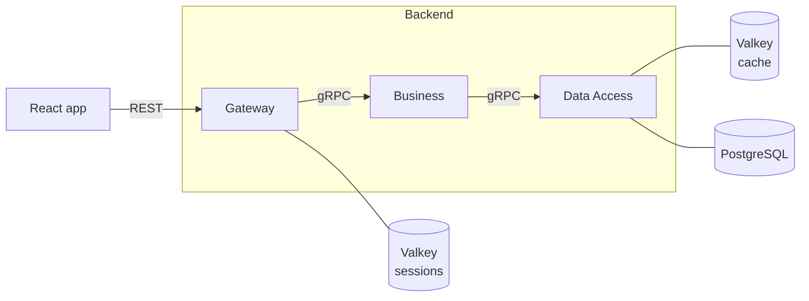

# ExpenseTracker

[](https://github.com/julio-jose-maldonado/ExpenseTracker/actions/workflows/ci.yml)

A responsive web app to log personal expenses: each user signs up and sees only their own expenses, with monthly totals per currency (ARS, USD, EUR) and per category.

> **This is a practice project, and it is deliberately over-engineered.**
> The domain is small on purpose. The real goals are to practice **gRPC** between services and **deploying to AWS** (ECS Fargate, RDS, ElastiCache, CDK). A single Express app with a database would be enough for this domain; three services talking over gRPC are not. That is the point.

## Architecture



| Service | Responsibility |
|---|---|
| **Gateway** | The only public entry point. REST routes, input validation, auth and sessions, rate limiting, translating error codes into the user's language. No business logic. |
| **Business** | Domain rules: per-user isolation, totals per currency and category. |
| **Data Access** | The only service that touches PostgreSQL. Owns the general-purpose cache. |

On AWS, each service will run as its own ECS Fargate service, with only the Gateway behind a load balancer. Locally, PostgreSQL and Valkey run in Docker and the three Node services run on the host.

## Highlights

- **Architecture rules enforced by tooling, not by convention.** [dependency-cruiser](.dependency-cruiser.cjs) fails the check if a service imports another service, a domain imports another domain, a layer skips one (Controller → Service → Repository → External service), or anything other than Data Access imports `pg` / `drizzle-orm`.
- **Errors travel as codes, never as text.** Business and Data Access return stable error codes in the gRPC status `details`; the Gateway maps them to HTTP status codes and translates them with i18next. Internal messages and stack traces stay in the logs.
- **Request IDs across all three services.** The Gateway accepts a valid `x-request-id` (or generates one), and it propagates through gRPC metadata and `AsyncLocalStorage` into every structured log line (pino).
- **Least-privilege database roles.** A `migrator` role owns the schema and runs migrations; the runtime role can only read and write data. Integration tests check that the app role cannot create or drop tables.
- **Typed contracts.** gRPC contracts in `.proto` files, linted with `buf` and compiled to TypeScript with `ts-proto`.
- **Decisions are documented** with the reasoning and the alternatives that were dropped: [`docs/Decisiones_Tecnicas.md`](docs/Decisiones_Tecnicas.md) (in Spanish).

## Tech stack

| Area | Choice |
|---|---|
| Backend | Node 24, TypeScript 7, Express 5 (Gateway), gRPC with `@grpc/grpc-js` + `ts-proto` (via `buf`), tsyringe for DI |
| Data | PostgreSQL 18, Drizzle ORM + `pg`, SQL migrations with `drizzle-kit` |
| Cache / sessions | Valkey (Redis-compatible): Docker locally, ElastiCache Valkey on AWS |
| Frontend | React 19 + Vite 8, TanStack Query, shadcn/ui + Tailwind 4, i18next (es / en). React Hook Form and Zustand come with the first user story |
| Quality | Jest + supertest (backend, transformed with SWC), Vitest + Testing Library (frontend), oxlint, dependency-cruiser |
| Infra *(planned)* | AWS CDK in TypeScript: ECS Fargate (3 services), RDS, ElastiCache, S3 + CloudFront, ALB in front of the Gateway only |
| Repo | pnpm workspace monorepo |

**Why TS 7, SWC and oxlint?** TypeScript 7 has no JS API yet, so tools that depend on it (ts-jest, ts-node, typescript-eslint) are out. Jest transforms with SWC, linting uses oxlint, and type checking runs as its own `tsc` step.

## Repository layout

```
App/               React web app (calls the Gateway through /api on the same origin)
Backend/
├── Gateway/       public REST API
├── Business/      domain rules
└── DataAccess/    PostgreSQL + cache
Packages/
├── proto/         gRPC contracts (.proto) and generated types
├── core/          shared backend code: errors, logger, request context, gRPC helpers
└── testing/       shared test helpers
docs/              technical decisions, backlog, local setup (Spanish)
```

Inside each service, code is organized by domain, with numbered layers: `2.Controller` → `3.Services` → `4.Repositories` → `5.ExternalServices`.

## Running locally

Requirements: Node 24, pnpm 11, Docker.

```sh
pnpm install
docker compose up -d --wait     # PostgreSQL + Valkey
pnpm build
```

Docker Compose and each service read their own `.env` file: copy the `.env.example` next to it and fill in the values. The values, and the steps to start the three services, are explained in [`docs/Desarrollo_Local.md`](docs/Desarrollo_Local.md).

```sh
curl localhost:3000/isAlive         # Gateway only
curl localhost:3000/isAliveChain    # Gateway → Business → Data Access → PostgreSQL
pnpm --filter @expense-tracker/app dev   # web app on http://localhost:5173
```

### Checks

```sh
pnpm typecheck
pnpm test          # unit tests (backend and web app), no Docker needed
pnpm lint
pnpm depcruise     # architecture rules
pnpm --filter @expense-tracker/data-access test:integration   # against the Docker PostgreSQL
```

[CI](.github/workflows/ci.yml) runs all of the above on every push and pull request, plus a [gitleaks](https://github.com/gitleaks/gitleaks) secret scan over the full git history.

## Status

Work in progress.

- [x] Monorepo, tooling and architecture rules
- [x] Skeleton of the three services with an end-to-end health check over gRPC
- [x] PostgreSQL and Valkey in Docker, database roles, Drizzle
- [x] Web app skeleton (Vite, Tailwind, shadcn/ui, TanStack Query, i18n) showing the end-to-end health check
- [ ] Sign up and log an expense *(first user story)*
- [ ] Log in / log out, edit and delete expenses, multi-currency, monthly totals, password recovery, language selection
- [ ] AWS deployment with CDK

The full backlog is in [`docs/backlog.md`](docs/backlog.md) (in Spanish).

## License

[MIT](LICENSE)
